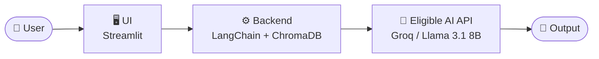

<div align="center">

# 🧠 RAGScript

### A privacy-first, local AI assistant that lets developers chat directly with their codebase.


**Built for the Hacktoberfest Islamabad 2026 · Open AI Build Challenge**

</div>

---

## 📑 Table of Contents

1. [Project and Problem](#1-project-and-problem)
2. [AI Component](#2-ai-component)
3. [System Architecture](#3-system-architecture)
4. [Setup and Usage](#4-setup-and-usage)
5. [Testing and Findings](#5-testing-and-findings)
6. [Team and Licensing](#6-team-and-licensing)

---

## 1. Project and Problem

### What is RAGScript?

**RAGScript** is a Retrieval-Augmented Generation (RAG) assistant that allows developers to have a natural-language conversation with their own source code. Point it at a project, index it locally, and ask questions such as *"Where is memory allocated in this module?"* or *"How does this class hierarchy fit together?"*, and receive grounded, context-aware answers.

### Target User

**Software developers**, especially those who:

- Join or inherit large, unfamiliar codebases and need to get up to speed quickly.
- Work with complex **object-oriented (OOP) and C++ projects**, where inheritance, templates, and manual memory management make code hard to trace.
- Handle proprietary or sensitive source code that cannot be pasted into public chat tools.

### The Problem

| Challenge | Why It Matters |
|---|---|
| **Code privacy** | Pasting proprietary code into cloud chat tools risks exposing intellectual property and violating company policy. |
| **Understanding complex codebases** | Deep OOP hierarchies and C++ constructs (pointers, heap allocation, templates, multiple inheritance) are slow and error-prone to read manually. |
| **Lack of codebase context** | General-purpose AI assistants have no awareness of *your* repository, so their answers are generic or inaccurate. |

### The Solution

RAGScript keeps your code **indexed locally** in a ChromaDB vector store. When you ask a question, only the **most relevant code chunks** are retrieved and sent to the language model, so the model never needs to see your entire repository. The result is fast, accurate, and context-grounded answers, with the privacy-conscious design developers expect.

**Key features**

- 💬 Chat with your codebase in plain English
- 🔒 Local-first indexing: your full source never leaves your machine
- 🔎 Semantic retrieval of relevant functions, classes, and files
- ⚡ Low-latency responses powered by Groq inference
- 🖥️ Clean, simple Streamlit interface

---

## 2. AI Component

RAGScript uses a large language model as its core reasoning engine.

| Property | Value |
|---|---|
| **Model Name** | Llama 3.1 |
| **Parameter Size** | 8B |
| **Provider** | Groq API |

**Role in the system:** Llama 3.1 8B acts as the **core reasoning engine for codebase retrieval and question answering (QA)**. After ChromaDB retrieves the code chunks most relevant to a user's query, the model reads those chunks together with the question, reasons over the code's structure and logic, and produces a clear, grounded explanation, including references to the relevant files and line numbers where available.

---

## 3. System Architecture




**Request flow**

1. The **user** submits a question about their codebase through the interface.
2. The **Streamlit UI** passes the query to the backend.
3. The **LangChain + ChromaDB backend** embeds the query, retrieves the most relevant code chunks, and builds a context-rich prompt.
4. The prompt is sent to **Llama 3.1 8B via the Groq API** for reasoning and answer generation.
5. The grounded **output** is returned and displayed in the chat interface.

---

## 4. Setup and Usage

### Prerequisites

- Python **3.10** or higher
- A free [Groq API key](https://console.groq.com/keys)

### Step 1: Clone the repository

```bash
git clone https://github.com/<your-username>/RAGScript.git
cd RAGScript
```

### Step 2: (Recommended) Create a virtual environment

```bash
python -m venv venv

# macOS / Linux
source venv/bin/activate

# Windows
venv\Scripts\activate
```

### Step 3: Install requirements

```bash
pip install streamlit langchain chromadb groq
```

### Step 4: Configure your environment variables

Create a `.env` file in the project root and add your Groq API key:

```bash
echo "GROQ_API_KEY=your_groq_api_key_here" > .env
```

Your `.env` file should look like this:

```env
GROQ_API_KEY=your_groq_api_key_here
```

> [!CAUTION]
> **Never commit your API keys.** Make sure `.env` is listed in your `.gitignore` before your first commit:
>
> ```bash
> echo ".env" >> .gitignore
> ```
>
> If a key is ever exposed publicly, revoke it immediately from the Groq console and generate a new one.

### Step 5: Run the app

```bash
streamlit run app.py
```

The app will open in your browser at `http://localhost:8501`.

### Usage

1. Load or point RAGScript to your project's source directory.
2. Wait for the codebase to be indexed into the local ChromaDB store.
3. Ask questions in the chat box, for example:
   - *"Explain how memory is allocated in `buffer_manager.cpp`."*
   - *"Which classes inherit from `BaseHandler`?"*
   - *"Summarize what this module does."*

---

## 5. Testing and Findings

| Scenario | Expected Output | Actual Outcome | Status |
|---|---|---|---|
| Querying memory allocation logic in a C++ file | Correctly identifies the line numbers and explains the heap allocation | Successfully retrieved and explained | ✅ Pass |

### ⚠️ Known Limitation

- Processing files **larger than 5MB takes longer than 15 seconds**. Very large files may cause noticeable delays during indexing and retrieval.

---

## 6. Team and Licensing

### 👥 Team

| Name | Role |
|---|---|
| **Muhammad Musa** | AI & Backend Logic |
| **Fatima Jawad** | Frontend Integration & Open-Source Lead |

### 📄 License

This project is licensed under the **MIT License**.

```text
MIT License

Copyright (c) 2026 Muhammad Musa and Fatima Jawad

Permission is hereby granted, free of charge, to any person obtaining a copy
of this software and associated documentation files (the "Software"), to deal
in the Software without restriction, including without limitation the rights
to use, copy, modify, merge, publish, distribute, sublicense, and/or sell
copies of the Software, and to permit persons to whom the Software is
furnished to do so, subject to the following conditions:

The above copyright notice and this permission notice shall be included in all
copies or substantial portions of the Software.

THE SOFTWARE IS PROVIDED "AS IS", WITHOUT WARRANTY OF ANY KIND, EXPRESS OR
IMPLIED, INCLUDING BUT NOT LIMITED TO THE WARRANTIES OF MERCHANTABILITY,
FITNESS FOR A PARTICULAR PURPOSE AND NONINFRINGEMENT. IN NO EVENT SHALL THE
AUTHORS OR COPYRIGHT HOLDERS BE LIABLE FOR ANY CLAIM, DAMAGES OR OTHER
LIABILITY, WHETHER IN AN ACTION OF CONTRACT, TORT OR OTHERWISE, ARISING FROM,
OUT OF OR IN CONNECTION WITH THE SOFTWARE OR THE USE OR OTHER DEALINGS IN THE
SOFTWARE.
```

### 🙏 Acknowledgements

RAGScript would not be possible without these outstanding tools and platforms:

- **[Groq](https://groq.com/)** for ultra-fast LLM inference and API access to Llama 3.1.
- **[LangChain](https://www.langchain.com/)** for the framework that orchestrates retrieval and generation.
- **[Streamlit](https://streamlit.io/)** for making a clean, interactive UI fast to build.

Built with ❤️ in Islamabad for **Hacktoberfest Islamabad 2026 · Open AI Build Challenge**.

---

<div align="center">

⭐ If you find RAGScript useful, consider giving the repo a star!

</div>
